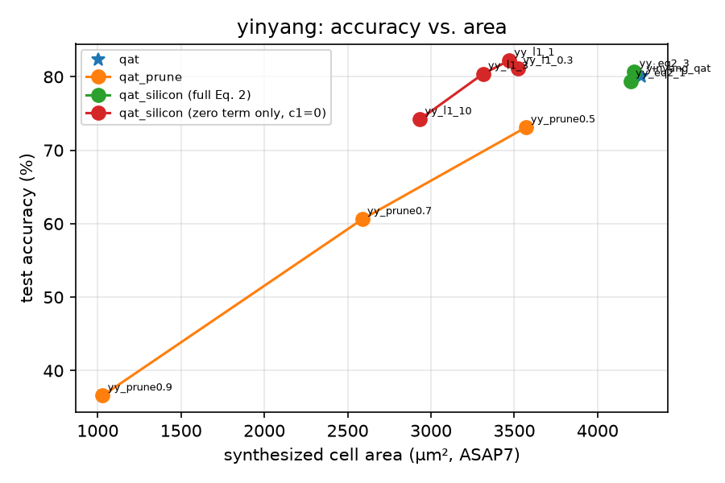

# snn2gds — snnTorch to ASIC

ECE 210 (Brain-Inspired Machine Learning, UCSC, Fall 2026) research project.
Wajid Ali · Jayaraj Jayakumar · Manish Pragaladan. Proposal: [`ECE210_Project_Fall26.pdf`](ECE210_Project_Fall26.pdf).

`snn2gds` takes a trained **snnTorch** model and produces a verified **ASAP7 layout**:

```
snnTorch train ──► extract w, β, θ ──► emit Verilog ──► Verilator ──► OpenROAD (ASAP7)
(quantized, β=1-2^-k)   (integers)    (weights as      spike match     area / timing / power
                                       constants)      (must be 100%)        │
        ▲                                                                    │
        └──────────── calibrate c0, c1 of the silicon-aware loss ◄───────────┘
```

Research question: can the chip be made smaller by changing the weights during training?
Each dataset is trained three ways (`qat`, `qat_prune`, `qat_silicon`), and we compare area at equal accuracy.

---

## Status

| Piece | State |
|---|---|
| Quantized snnTorch training (`snn.Leaky`, β = 1-2^-k, floor state quantizer, fake-quant weights) | ✅ |
| Export to integers + bit-exact NumPy reference | ✅ snnTorch == integer model, 100% spike match |
| Verilog generator (weights as constants, P = N_in) + self-checking testbench | ✅ |
| RTL spike match in Verilator and Icarus | ✅ 100% on every layer and step; a corrupted weight is caught |
| OpenROAD-flow-scripts (ASAP7) synth + place & route through global route | ✅ detailed route runs out of memory on 16 GB, see Results |
| Area calibration of Eq. (2) | ✅ runs; finding below |
| Datasets: Yin-Yang, Braille, N-TIDIGITS (download + loaders) | ✅ |
| Pruning and silicon-aware training modes | ✅ Yin-Yang sweep done: −22% area at equal accuracy, see Results |
| Experiment sweep + accuracy-vs-area plot | ✅ script, not run yet |
| P < N_in (time-multiplexed synapse adder) | ⬜ TODO |

Baseline results so far are in [Results](#results).

---

## Setup

Requirements: Linux, Python ≥ 3.10, a C++ compiler, and a built
[OpenROAD-flow-scripts](https://github.com/The-OpenROAD-Project/OpenROAD-flow-scripts) (ORFS).
A GPU helps but isn't required.

```bash
git clone <this repo> && cd Snntorch_to_asic
make setup                     # .venv + torch + snnTorch + tonic; builds Verilator 5.030 into tools/ if missing
# CPU-only machine:  TORCH_CUDA=cpu make setup
```

### OpenROAD-flow-scripts (external repo, not vendored)

ORFS is large and takes about an hour to build, so we point to it instead of copying it.
`snn2gds` looks for it in this order:

1. `$ORFS_HOME`
2. `third_party/OpenROAD-flow-scripts` (git submodule pinned to ORFS commit `e5346a7`, which the results were made with)
3. `~/OpenROAD-flow-scripts`

```bash
# option A: you already have a built ORFS
export ORFS_HOME=/path/to/OpenROAD-flow-scripts

# option B: use the pinned submodule and build it
git submodule update --init --depth 1 third_party/OpenROAD-flow-scripts
cd third_party/OpenROAD-flow-scripts && ./build_openroad.sh --local    # see ORFS docs

# option C: ORFS docker image (see ORFS docs), then set ORFS_HOME inside the container
```

Tool versions used: OpenROAD `v2.0-27655-gf9a6acaf77`, Yosys 0.60 (both from ORFS), Verilator 5.030,
Icarus Verilog 12, torch 2.11 + CUDA 12.8, snnTorch 1.0.0, tonic 1.7.

Headless note: if ORFS crashes at the end of `6_report` with no `$DISPLAY`, guard the `gui::show` call in
`flow/scripts/final_report.tcl` with `[info exists ::env(DISPLAY)]` (our local ORFS has this one-line patch).

---

## Quick start

```bash
make flow CFG=configs/yinyang.yaml          # train -> export -> rtl -> sim -> synth -> report  (~10 min)
make grt  CFG=configs/yinyang.yaml          # place & route up to global route (~15 min)
make pnr  CFG=configs/yinyang.yaml          # full flow incl. detailed route (needs >16 GB RAM today)
```

Each step can be run on its own, and any config key can be overridden on the command line:

```bash
.venv/bin/python -m snn2gds train  configs/yinyang.yaml name=yy_bw6 quant.bw=6 train.epochs=10
.venv/bin/python -m snn2gds export configs/yinyang.yaml name=yy_bw6
.venv/bin/python -m snn2gds rtl    configs/yinyang.yaml name=yy_bw6
.venv/bin/python -m snn2gds sim    configs/yinyang.yaml name=yy_bw6 --sim iverilog
.venv/bin/python -m snn2gds synth  configs/yinyang.yaml name=yy_bw6     # ORFS synth only, minutes
.venv/bin/python -m snn2gds pnr    configs/yinyang.yaml name=yy_bw6     # ORFS full flow
.venv/bin/python -m snn2gds report configs/yinyang.yaml name=yy_bw6     # -> runs/yy_bw6/summary.json
```

Experiments (Section 5) and calibration:

```bash
.venv/bin/python -m snn2gds.calibrate --jobs 4             # -> runs/calib/calibration.json
.venv/bin/python scripts/run_experiments.py configs/yinyang.yaml --calib runs/calib/calibration.json
.venv/bin/python scripts/run_experiments.py configs/braille.yaml --pnr   # add full P&R
# -> results/<dataset>.csv, results/<dataset>_acc_vs_area.png
```

---

## Repository layout

```
configs/              one YAML per dataset (quant, training, hardware settings)
snn2gds/
  config.py           dataclass config + YAML loading + dotted overrides
  datasets.py         Yin-Yang (generated), Braille (Zenodo), N-TIDIGITS (tonic) -> [N, T, C] spikes
  quant.py            STE quantizers, snnTorch state quantizer, bit-exact integer reference
  model.py            plain snnTorch net: Linear(no bias) -> snn.Leaky -> Linear -> snn.Leaky
  train.py            qat | qat_prune | qat_silicon (Eq. 2)
  export.py           read w, β, θ out of the snnTorch modules; check snnTorch == integer model
  rtlgen.py           Verilog: synapse sums with constant weights, layers, top, testbench
  sim.py              Verilator (default) or Icarus; checks every spike of every layer
  pnr.py              writes ORFS config.mk / SDC, runs ORFS, collects metrics
  calibrate.py        synthesizes test layers and fits c0, c1 of Eq. 2
  report.py           merges metrics into runs/<name>/summary.json
rtl/snn_lif.v         hand-written LIF neuron (copied into every generated design)
scripts/              setup.sh, install_verilator.sh, run_experiments.py
third_party/          ORFS submodule pointer (not checked out by default)
data/  runs/  tools/  generated, git-ignored
```

Each run writes everything under `runs/<name>/`:
`model.pt`, `train_log.json`, `export.json`, `ref/` (stimuli + expected spikes), `rtl/`, `sim/`,
`orfs/` (config.mk, SDC, and ORFS `work/` with logs, reports, results, final `6_final.gds`), and `metrics_*.json`.

---

## How the flow works

### Fixed-point neuron (bit-exact across snnTorch, NumPy, and RTL)

All integers are in units of 2^-f. Weights: `w_int = clamp(round(w·2^f), ±2^(bw-1))`, threshold
`θ_int = round(θ·2^f)`, membrane a `bu`-bit two's-complement register. Per time step:

```
s_prev = U > θ_int
U      = U + ((-U) >>> k) + Σ_i w_ji·s_i[t] − θ_int·s_prev      # (-U)>>>k == −ceil(U/2^k)
spike  = U > θ_int
```

This is exactly what `snn.Leaky(beta=1-2**-k, reset_mechanism="subtract", state_quant=floor_to_2^-f)` computes
in snnTorch 1.0 (default `reset_delay=True`, strict `>` in the surrogate's forward pass). The leak comes out as
`U − ceil(U/2^k)` instead of `U − floor(U/2^k)` because snnTorch floors after `β·U`; the RTL matches that.
`export` checks the match on the whole test set and flags any membrane overflow of `bu` bits.

### Hardware (current: P = N_in)

- `snn_top_syn<l>`: for each neuron, `I_j = Σ (s_i ? w_ji : 0)` with the trained weights as Verilog constants.
  Zero weights are left out; Yosys/ABC builds only what the constants need.
- `snn_lif`: membrane register, shift-leak, compare, subtract-reset. No multipliers, no SRAM.
- Layers are pipelined one cycle apart; one input time step per clock.
- Top: `clear`, `in_valid`, `in_spikes[N_in]` in; `out_spikes`, per-class spike `out_counts`, `done` out.
  The class is the argmax of the counts (done in software for now).

### Verification

`export` saves the input spikes of `n_verify` test samples and the integer model's spikes for every layer at every
step. The generated `tb.v` replays them and compares **every spike of every layer**. It prints
`SPIKE_MATCH PASS` or the first mismatches. It also dumps the output counts, so `sim` reports RTL accuracy.

### Physical design

`pnr.py` writes `runs/<name>/orfs/config.mk` (ASAP7, `CORE_UTILIZATION`, `PLACE_DENSITY`) and
`constraint.sdc` (`hw.clk_period_ps`), then runs ORFS with `WORK_HOME=runs/<name>/orfs/work`, so the ORFS tree
is never modified. Flow settings are fixed in the config so only the model changes between runs.

---

## Datasets

| Dataset | Source | Encoding (T = 100) | Split |
|---|---|---|---|
| Yin-Yang | generated (re-implementation of Kriener et al. 2022) | 4 inputs (x, y, 1-x, 1-y), one latency spike each | 5000 / 1000, seeds 42 / 40 |
| Braille | Zenodo [7050094](https://zenodo.org/records/7050094), `data_braille_letters_th_1.pkl` | 12 taxels × ON/OFF = 24 ch, 1.25 s window | random 80/20 (seed 0) |
| N-TIDIGITS | tonic `NTIDIGITS18` (441 MB hdf5), single digits | 64 cochlea channels, 1.4 s window (99th pct. length) | official 2463 / 2486 |

Downloads happen on first use into `data/`; the binned tensors are cached as `data/<name>_T<T>.npz`.
The Braille and N-TIDIGITS files are pickle/hdf5 from the dataset authors; only load copies from those sources.

---

## Results

_Baseline (`qat`), filled in from the runs in this repo; see `runs/<name>/summary.json`._

**Yin-Yang, 4 → 128 → 3, T = 100, bw = 8, f = 4, k = 5, ASAP7, clock 1000 ps**

| Metric | `yinyang_qat` (30 epochs) | `yy_smoke` (8 epochs) |
|---|---|---|
| Test accuracy (snnTorch = integer model) | 80.0% | 81.7% |
| RTL spike match (200 samples, every layer and step) | 100% | 100% |
| Weights: zero / power-of-two / other | 27 / 232 / 637 | 24 / 254 / 618 |
| Synthesis cell area | 4,262 µm² (33.8k cells) | 4,306 µm² (34.3k cells) |
| After global route: std-cell area | not run | **4,806 µm²** (utilization 44.8%, core 10,722 µm²) |
| After global route: setup WNS | not run | −191 ps (about 840 MHz reachable) |
| After global route: wirelength / power | not run | 174.6 mm / 0.22 W |

Area after global route is about 12% above synthesis area, because of timing-repair buffers and the clock tree.

**Detailed routing doesn't finish on a 16 GB machine yet.** The router used about 12–13 GB at 8 and 20 threads,
starting with about 4.9k violations mostly on M1/M2, and was killed or stopped. Until that's fixed, use
`python -m snn2gds grt ...`, which stops after global routing. Things to try: lower `hw.place_density` and
`hw.core_utilization`, use `hw.num_cores=4`, or run detailed routing on a larger-memory machine.

### Area reduction: pruning vs. silicon-aware training (Yin-Yang)

One run per point, seed 0, 30 epochs, synthesis area (ASAP7). Every model passes the 100% RTL spike match.
Reproduce with `scripts/sweep_yinyang.sh` and then `scripts/compare.py yinyang_qat 'yy_*'`.

| Run | Method | Accuracy | Δ acc (pts) | Weights zero / pow2 / other | Area (µm²) | Area saving |
|---|---|---|---|---|---|---|
| `yinyang_qat` | baseline QAT | 80.0% | — | 27 / 232 / 637 | 4,262 | — |
| `yy_prune0.5` | QAT + 50% pruning | 73.1% | −6.9 | 448 / 73 / 375 | 3,568 | 16.3% |
| `yy_prune0.7` | QAT + 70% pruning | 60.6% | −19.4 | 627 / 32 / 237 | 2,587 | 39.3% |
| `yy_prune0.9` | QAT + 90% pruning | 36.6% | −43.4 | 805 / 6 / 85 | 1,029 | 75.8% |
| `yy_l1_0.3` | silicon-aware, zero term only, λ = 0.3 | 81.1% | +1.1 | 111 / 185 / 600 | 3,522 | 17.4% |
| `yy_l1_1` | silicon-aware, zero term only, λ = 1 | 82.2% | +2.2 | 143 / 200 / 553 | 3,469 | 18.6% |
| `yy_l1_3` | silicon-aware, zero term only, λ = 3 | 80.4% | +0.4 | 204 / 199 / 493 | 3,312 | **22.3%** |
| `yy_l1_10` | silicon-aware, zero term only, λ = 10 | 74.2% | −5.8 | 319 / 173 / 404 | 2,933 | 31.2% |
| `yy_eq2_1` | silicon-aware, full Eq. 2 (c1 = c0), λ = 1 | 79.4% | −0.6 | 53 / 332 / 511 | 4,198 | 1.5% |
| `yy_eq2_3` | silicon-aware, full Eq. 2 (c1 = c0), λ = 3 | 80.7% | +0.7 | 81 / 361 / 454 | 4,220 | 1.0% |



What these runs show:
- **Silicon-aware training reduces area by 22% with no accuracy loss** (λ = 3). At about −6 accuracy points it saves
  31%, while 50% pruning saves 16% for −6.9 points. Its curve lies above and to the left of pruning's.
- Pruning saves more area than the per-weight count model predicts. When every input of a hidden neuron is zero,
  synthesis removes the whole neuron.
- The power-of-two term of Eq. 2, as written, barely reduces area (1–1.5%). It raises the number of power-of-two
  weights, but it also pulls weights away from zero, because the nearest power of two is never zero. This agrees
  with the negative c1 from calibration below.

Caveats: one seed per point, so differences of about ±2 accuracy points are noise. These are synthesis areas, not
post-layout areas. Yin-Yang is the bring-up dataset, and the 128 neurons dominate its area.

### Calibration finding (Eq. 2)

`snn2gds.calibrate` synthesized 16 single-layer test designs (32 inputs × 16 neurons, mixed zero / power-of-two /
other weights) and fit `area = a0 + c0·Σ|w| + c1·Σ(w − p2(w))²`:

| fit | result | R² |
|---|---|---|
| Eq. 2 features | c0 = 0.073 µm²/unit, **c1 = −0.028** | 0.86 |
| per-weight counts | zero ≈ 0, power-of-two ≈ **0.65 µm²**, other ≈ **1.04 µm²** (base 486 µm²) | 0.93 |

The count fit supports the premise: a power-of-two weight costs about 60% of an arbitrary one, and a zero weight
costs nothing. But the squared distance to the nearest power of two grows with the square of the weight's
magnitude, while area grows roughly with its bit width, so the fitted c1 comes out negative. **Before running the
`qat_silicon` sweep, decide how to fix Eq. 2**, for example by normalizing the distance (`|w − p2(w)| / |w|`) or by
using a smooth per-weight indicator. Raw numbers are in `runs/calib/calibration.json`.

---

## Roadmap / requirements (to be filled in by the team)

- [ ] Decide the fix for the c1 term of Eq. 2 (see above), re-run calibration, then the `qat_silicon` sweep
- [x] Yin-Yang sweep (`scripts/sweep_yinyang.sh`)
- [ ] Same sweep with 3 seeds per point; then Braille (first layout), then N-TIDIGITS (main)
- [ ] Hyperparameter tuning per dataset (epochs, lr, `init_gain`, k, θ, bw, f) to get reasonable baselines
- [ ] Get detailed routing to fit in 16 GB (lower density/utilization, fewer threads) or run it on a bigger machine
- [ ] Time-multiplexed synapse (`hw.P < N_in`): area vs. latency trade-off
- [ ] Hardware argmax / classifier output; optionally power from ORFS (`power_w` is already collected)
- [ ] Per-layer k / θ in export and RTL (currently shared across layers)
- [ ] Final plots: accuracy vs. area per dataset for the three methods
- [ ] _add requirements here_

---

## References

See the proposal PDF. Key tools: snnTorch (Eshraghian et al., Proc. IEEE 2023), OpenROAD / ORFS (Ajayi et al., DAC 2019),
ASAP7 PDK, Verilator, tonic.
